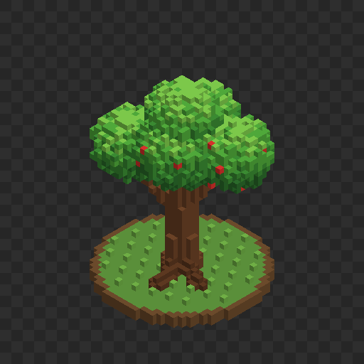

# mcp-magicavoxel

Servidor [MCP](https://modelcontextprotocol.io) que permite a un agente de IA (Claude Code, Claude Desktop, Cursor…) **construir modelos voxel, guardarlos como archivos `.vox` de [MagicaVoxel](https://ephtracy.github.io/) y exportarlos a Godot u otros motores como `.glb` listos para animar**.

Pídele a tu agente *"crea un árbol en voxel y guárdalo como tree.vox"* y lo construirá con primitivas, revisará el resultado con vistas previas en PNG y guardará un archivo listo para abrir en MagicaVoxel.



*Vista previa del manzano de ejemplo ([`docs/tree.vox`](docs/tree.vox)), creado por Claude Code con este servidor.*

## Características

- Escribe `.vox` en formato **200** (el de MagicaVoxel 0.99.7), con grafo de escena, paleta y materiales.
- Varios objetos por escena, cada uno de hasta 256×256×256.
- Primitivas: cajas, esferas/elipsoides, cilindros/conos, líneas, voxeles sueltos y simetría.
- Generación procedural con expresiones JavaScript por voxel.
- Copias en espejo, reemplazo de colores e importación de objetos desde otros `.vox`.
- Deshacer (hasta 30 pasos); una operación que falla no deja cambios a medias.
- **Personajes articulados**: puntos de giro, jerarquía de piezas y puntos de enganche para accesorios.
- **Vistas previas con pose**: rota piezas alrededor de sus articulaciones para comprobar cómo se doblan.
- **Exportación `.glb`** con mallas optimizadas, jerarquía, pivotes y una textura de paleta para cambiar colores en el juego.
- Materiales de MagicaVoxel: metal, vidrio y emisivo.
- Paleta automática: los colores se indican en hex (`"#ff8800"`).
- Sin dependencias nativas: solo Node.js.

## Requisitos

- Node.js 18 o superior
- MagicaVoxel (para abrir los `.vox`)

## Instalación

```bash
git clone https://github.com/Anthonyzok521/mcp-magicavoxel.git
cd mcp-magicavoxel
npm install
```

### Claude Code

```bash
claude mcp add voxel -s user -e VOX_OUTPUT_DIR="/ruta/a/MagicaVoxel/vox" -- node /ruta/a/mcp-magicavoxel/src/server.mjs
```

Reinicia Claude Code y comprueba con `claude mcp list` que `voxel` aparece como conectado.

### Otros clientes MCP (Claude Desktop, Cursor…)

```json
{
  "mcpServers": {
    "voxel": {
      "command": "node",
      "args": ["/ruta/a/mcp-magicavoxel/src/server.mjs"],
      "env": { "VOX_OUTPUT_DIR": "/ruta/a/MagicaVoxel/vox" }
    }
  }
}
```

`VOX_OUTPUT_DIR` es la carpeta donde se guardan los nombres de archivo relativos. Si apunta a la carpeta `vox` de MagicaVoxel, los modelos aparecen directamente en su lista de archivos. Si no se define, se usa el directorio de trabajo del servidor.

## Herramientas

### Modelado

| Herramienta | Descripción |
|---|---|
| `new_scene` | Vacía la escena |
| `create_model` | Crea un objeto (tamaño y posición en el mundo) |
| `move_model` / `delete_model` | Mueve o elimina un objeto |
| `duplicate_model` | Copia un objeto, opcionalmente en espejo respecto a un plano (por ejemplo, el brazo izquierdo a partir del derecho) |
| `fill_box` | Caja maciza o hueca, con `bevel` para biselar las aristas a 45° (estilo low-poly) |
| `fill_sphere` | Esfera o elipsoide, maciza o hueca |
| `fill_cylinder` | Cilindro o cono en el eje x, y o z |
| `draw_line` | Línea entre dos puntos, con grosor |
| `set_voxels` | Voxeles individuales |
| `fill_expression` | Pinta con una expresión JavaScript evaluada por voxel |
| `mirror` | Refleja una mitad del objeto sobre la otra |
| `replace_color` | Cambia colores en uno o varios objetos (variantes de equipo o de piel) |
| `set_material` | Asigna material diffuse, metal, glass o emit a un color |
| `undo` | Deshace el último cambio |

### Articulaciones y poses

| Herramienta | Descripción |
|---|---|
| `set_pivot` | Punto de giro de una pieza (coordenadas o `anchor`: top, bottom, center) y su pieza padre |
| `set_attachment` | Punto de enganche con nombre (sombrero, arma, mochila…) que sigue a su pieza |
| `render_preview` | Imágenes PNG desde una o varias vistas; con `pose` rota piezas alrededor de sus pivotes |

### Archivos

| Herramienta | Descripción |
|---|---|
| `save_vox` / `load_vox` | Guarda o carga `.vox`; la información de articulaciones va en `<nombre>.rig.json` |
| `import_model` | Trae objetos de otro `.vox` a la escena actual, con sus colores y articulaciones |
| `export_glb` | Exporta a glTF binario (`.glb`) para Godot y otros motores |
| `get_scene_info` | Objetos, tamaños, voxeles, articulaciones y colores usados |

Cualquier herramienta de pintura acepta el color `"empty"` para borrar voxeles.

### Coordenadas

Igual que MagicaVoxel: **x** hacia la derecha, **y** en profundidad (el frente tiene y baja) y **z hacia arriba**. Las coordenadas de las herramientas de pintura son locales a cada objeto; `position`, los pivotes y los puntos de enganche están en coordenadas del mundo.

Las rotaciones de `pose` son `[rx, ry, rz]` en grados sobre esos mismos ejes, aplicadas en orden x, y, z. Cada pieza gira alrededor de su pivote y arrastra a sus piezas hijas.

## Personajes articulados

1. Construye cada parte del cuerpo como un objeto separado: cabeza, torso, brazo, antebrazo, muslo, espinilla…
2. Define su articulación y su pieza padre con `set_pivot`, por ejemplo el antebrazo con pivote en el codo y padre `upper_arm_r`.
3. Haz la otra mitad con `duplicate_model` en espejo: el pivote también se refleja.
4. Comprueba los movimientos con `render_preview` y `pose`, por ejemplo `{"upper_arm_r": [-80, 0, 0], "forearm_r": [-30, 0, 0]}`.
5. Añade puntos de enganche con `set_attachment` (`hat`, `weapon_r`, `back`…).
6. `save_vox` guarda el modelo y su `.rig.json`; `export_glb` lo lleva al motor.

## Exportar a Godot

`export_glb` genera un `.glb` (glTF 2.0) que Godot 4 importa directamente:

- **Una malla por objeto**, optimizada uniendo caras contiguas del mismo color.
- **Jerarquía de nodos** según las piezas padre, con el origen de cada nodo en su pivote: para animar basta rotar el nodo.
- **Puntos de enganche** como nodos vacíos, para colgar accesorios o armas.
- **Textura de paleta** de 256×1 con filtro *nearest*: para cambiar un color en el juego (piel, equipo) basta modificar o sustituir esa textura.
- **Ejes convertidos a glTF**: y hacia arriba, frente hacia +z.
- `origin: "feet"` (por defecto) centra el modelo y apoya su voxel más bajo en y = 0; `origin: "world"` conserva las coordenadas de MagicaVoxel.
- `voxel_size` fija los metros por voxel (0.05 por defecto; con 0.04, un personaje de 46 voxeles mide 1,84 m).

Probado con el validador de Khronos (0 errores) y con la importación de Godot 4.7.1.

## Limitaciones

- La vista previa usa sombreado plano: sirve para comprobar forma, color y poses, no es el path tracer de MagicaVoxel.
- Al cargar un `.vox` se conservan las posiciones de los objetos, pero no las rotaciones, los fotogramas de animación ni la configuración de render (cámaras, luces).
- La información de articulaciones vive en el `.rig.json`: MagicaVoxel no la conoce, así que si editas el `.vox` en MagicaVoxel conserva los nombres de los objetos.
- Los materiales pertenecen a los colores de la paleta: todos los voxeles de un mismo color comparten material. `export_glb` no exporta los materiales metal, vidrio ni emisivo.
- La paleta admite 255 colores. Cuando se llena, los colores nuevos se aproximan al más parecido.
- `fill_expression` ejecuta el código en un contexto `vm` de Node con un límite de 20 segundos. **No es un sandbox de seguridad**: úsalo solo con agentes y código en los que confíes.

## Desarrollo

```bash
npm test                                 # prueba de extremo a extremo por stdio
node test-e2e.mjs <salida> <carpeta_vox> # además carga y dibuja los ejemplos de MagicaVoxel
```

- `src/vox.mjs`: modelo en memoria y lectura/escritura del formato `.vox`.
- `src/rig.mjs`: pivotes, jerarquía, poses y el archivo `.rig.json`.
- `src/render.mjs`: trazador de rayos ortográfico (con poses) y codificador PNG.
- `src/glb.mjs`: mallado optimizado y exportación glTF binaria.
- `src/server.mjs`: servidor MCP y sus herramientas.

Referencia del formato: [voxel-model](https://github.com/ephtracy/voxel-model) de ephtracy.

MagicaVoxel es un programa de [ephtracy](https://ephtracy.github.io/). Este proyecto no está afiliado a él.

## Licencia

[MIT](LICENSE) © Anthonyzok521
